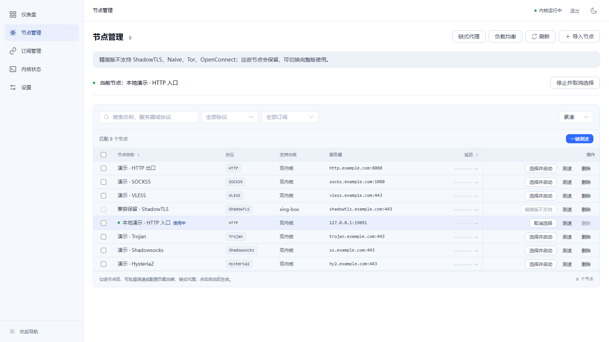

# DuoRelay

[简体中文](README.md) | English

DuoRelay is a web-based proxy management panel built around sing-box and mihomo. The repository provides **duorelay** (full, dual kernel) and **duorelay-lite** (mihomo only), sharing the same version, panel and data format. Lite retains node and subscription management, load balancing, native chains, routing editors, transparent proxy options, kernel validation and rollback. It supports the 24 protocol and endpoint capabilities available through mihomo; ShadowTLS, Naive, Tor and OpenConnect require the full build. See the [lite guide](docs/lite.en.md) and [acceptance report](docs/lite-acceptance.en.md) for details.

```bash
make build-lite
bash scripts/package-linux.sh 0.3.0 amd64 --lite
# Windows: powershell -File scripts/package-windows.ps1 -Version 0.3.0 -Lite
```


## Interface and package sizes

Local version 0.3.0 builds measured the following compressed sizes in decimal MB, including the panel, kernels and bundled documentation, but excluding Geo data:

| Platform | Full | Lite |
|---|---:|---:|
| Linux amd64 | 62.34 MB | 34.66 MB |
| Linux arm64 | 56.91 MB | 31.83 MB |
| Windows amd64 | 66.56 MB | 34.34 MB |



The screenshot comes from a temporary demonstration instance. Further measurements and screenshots are in the [showcase](docs/showcase.en.md); these are local build records rather than a separate release. See the [lite acceptance report](docs/lite-acceptance.en.md) for unverified items.

## Features

| Feature | Description |
|---|---|
| Kernels | Generate sing-box and mihomo configurations and manage kernel processes, subject to kernel and protocol capabilities. |
| Web management | Create an administrator on first access; manage nodes, subscriptions, kernels, connections and logs. |
| Nodes and subscriptions | Import common share links and subscription formats; test latency, delete selected nodes in batches, and use load balancing or proxy chains. |
| Software updates | Check GitHub releases matching the full/lite build and platform under **Settings → About**. One-click updates require a writable install directory; use the deployment guide for protected Linux systemd installs. |
| Routing | Edit structured rules as a list or text, import and export them, and validate individual lines. |
| Configuration safety | Validate with the relevant kernel before applying; retain or restore the previous state on failure. |
| Monitoring | Inspect kernel logs, connections and sampled traffic history. |
| System integration | Linux transparent proxy and Windows system proxy options; see the acceptance documents for verification limits. |

## Protocols and limitations

The project covers a unified model, parsing or configuration generation for 28 protocols, endpoints and networking capabilities. Coverage does **not** mean all protocols have been tested against real nodes. Availability depends on kernel version, configuration and remote services.

| Scope | Protocols or capabilities |
|---|---|
| Both kernels | Shadowsocks, VMess, VLESS, Trojan, Hysteria, Hysteria2, TUIC, AnyTLS, Snell, SOCKS5, HTTP, SSH, WireGuard, OpenVPN, MASQUE, Tailscale |
| sing-box | ShadowTLS, Naive, Tor, OpenConnect |
| mihomo | ShadowsocksR, Mieru, Sudoku, ShadowQUIC, TrustTunnel, Rematch, EasyTier, ZeroTier |

See [subscription formats](docs/subscription-formats.en.md), [multi-node proxy](docs/multi-node-proxy.en.md) and [application updates](docs/app-update.en.md) for limitations. Traffic history consists of Clash API rate samples, not cumulative per-user or per-node accounting.

## Quick start

### Docker

Clone the repository and choose one variant. Full supports Linux amd64; lite supports Linux amd64 and arm64.

```bash
# Full: sing-box and mihomo
docker compose up -d --build

# Lite: mihomo only
docker compose -f compose.yaml -f compose.lite.yaml up -d --build
```

Run only one command. The panel defaults to `127.0.0.1:8080` on the host. Both variants use the same service and data volume; stop the existing service and back up data before switching. Lite downloads its Geo cache on first start. See [Docker deployment](docs/docker-deployment.en.md) for installation, proxy ports, switching and updates.

### Linux installation

On Linux amd64 or arm64 with systemd:

```bash
# Full
curl -fsSL https://raw.githubusercontent.com/HlONGlin/DuoRelay/master/scripts/bootstrap-linux.sh | sudo bash -s -- --full

# Lite
curl -fsSL https://raw.githubusercontent.com/HlONGlin/DuoRelay/master/scripts/bootstrap-linux.sh | sudo bash -s -- --lite
```

The script builds the frontend and backend, downloads kernels and installs a systemd service. Debian, Ubuntu and common apt-based derivatives may install dependencies automatically; other distributions require dependencies to be installed first. You need the Go version in `go.mod` (currently 1.27.0), Node.js 18 or 20+ (22 recommended), npm and Git. Alpine, OpenWrt, containers without systemd and 32-bit systems are not supported by this entry point. Real-host installation on individual distributions remains unverified; see [Linux deployment](docs/linux-deployment.en.md).

The script handles initial installation only and exits if an existing system installation is detected. Data is stored in `/var/lib/duorelay`. Private repositories require access credentials. Follow the deployment guide for upgrades and variant changes.

### Build from source

The following Linux example requires the Go version declared in `go.mod`, Node.js/npm, `make`, Git and the appropriate kernels. The kernel download script records digests but does not validate them against pre-pinned hashes; see [Linux deployment](docs/linux-deployment.en.md).

```bash
git clone https://github.com/HlONGlin/DuoRelay.git
cd DuoRelay
./scripts/download-kernels.sh
make build
./build/duorelay -kernels ./kernels
```

Open `http://127.0.0.1:8080/` and create an administrator on first access. If applying a configuration fails, inspect the panel error and kernel logs.

## Deployment and management

See the [Linux deployment guide](docs/linux-deployment.en.md), [Windows deployment guide](docs/windows-deployment.en.md), and [development guide](docs/DEVELOPMENT.en.md). Run `./build/duorelay -h` for all options.

| Option | Default | Purpose |
|---|---|---|
| `-listen` | `127.0.0.1:8080` | Panel listen address |
| `-db` | `data/duorelay.db` | SQLite database path |
| `-kernels` | `kernels` | Kernel executable directory |
| `-config-dir` | `data/configs` | Generated configuration directory |
| `-cookie-secure` | `false` | Set Secure session cookies behind an HTTPS reverse proxy |

Back up the entire data directory when migrating, especially the database and its `.key` file. Losing the key makes encrypted subscription URLs unrecoverable.

## Routing and transparent proxy

Internal routing, bypass rules and user rules are matched in that order. The default dedicated SOCKS5 port is `10808`. Settings → General can add up to 32 extra SOCKS5 listeners, each pinned to a node and independent of the active proxy and routing rules. Listeners inherit the inbound listen address; full supports sing-box or mihomo, while lite uses mihomo, subject to the active kernel's protocol support. Save settings and reapply the configuration to activate changes. Enabling LAN access also exposes these ports to the LAN. The node page also supports selecting and batch-deleting nodes. See [node management and multi-node proxy](docs/multi-node-proxy.en.md) for deletion rules and proxy setup, [application updates](docs/app-update.en.md) for update limitations, and [routing acceptance](docs/routing-acceptance.en.md) for rule validation and text format details.

| System | Current limits |
|---|---|
| Linux | `redirect`, `tproxy` and `tun` are available; verification of permissions, DNS and real traffic differs by mode. |
| Windows | System proxy affects the current user; restoration and TUN still require real Windows acceptance testing. |
| macOS | TUN has not been verified on a real system. |

Transparent proxy does not guarantee capture of all traffic or DNS leak protection. Linux redirect does not capture UDP DNS. See [transparent proxy acceptance](docs/transparent-proxy-acceptance.en.md) and [container acceptance](docs/container-acceptance.en.md).

## Testing and development

```bash
go test ./...
go vet ./...
cd web
npm ci
npm run type-check
npm test
npm run build
```

These checks do not replace real network acceptance testing. Transparent proxy testing also requires an isolated network, temporary node, observable proxy exit, and snapshots of rules and routes before and after operation. See the acceptance documentation for limits.

## Documentation

The [documentation index](docs/README.en.md) links to usage, development, architecture and acceptance documents. Historical reports and designs remain as originally written; consult the code and latest acceptance records for current capabilities.

## License

DuoRelay's license has not yet been determined. sing-box and mihomo each use GPLv3; consult their respective licenses when using or distributing the kernels.

The project is intended for learning and research. Users must comply with applicable local laws and regulations. The project was developed with assistance from [Claude Code](https://claude.com/claude-code).
