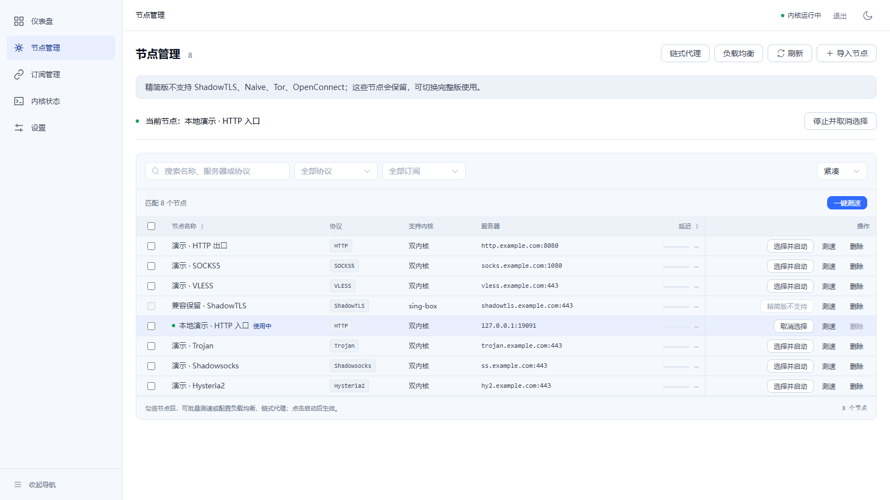

# DuoRelay

同库提供 **duorelay（full 双核）** 与 **duorelay-lite（mihomo 单核）**，共用版本号、完整面板和数据格式。lite 保留节点、订阅、负载均衡、原生链式、路由双模式编辑、透明代理、真核校验和失败回滚；支持 mihomo 的 24 项协议/端点能力，禁用 ShadowTLS、Naive、Tor、OpenConnect。协议对照、Geo 下载、构建与数据迁移见 [精简版说明](docs/lite.md)，实测结果见 [lite 验收报告](docs/lite-acceptance.md)。

```bash
make build-lite
bash scripts/package-linux.sh 0.3.0 amd64 --lite
# Windows: powershell -File scripts/package-windows.ps1 -Version 0.3.0 -Lite
```

> 基于 sing-box 与 mihomo 的双内核代理管理面板，使用 Web 界面管理节点、订阅、路由和内核运行状态。


## 界面与体积实测

**lite 压缩包 31.83 MB 起，保留完整面板。** 同版本 `0.3.0` 本地构建实测如下（十进制 MB，包含面板、对应内核及随包文档，不含 Geo）：

| 平台 | full 压缩包 | lite 压缩包 |
|---|---:|---:|
| Linux amd64 | 62.34 MB | **34.66 MB** |
| Linux arm64 | 56.91 MB | **31.83 MB** |
| Windows amd64 | 66.56 MB | **34.34 MB** |



截图来自 orca-linux 中的临时演示实例。解压后的文件大小、首次 Geo 缓存、仪表盘 / 链式 / 路由截图与功能介绍见 [图文介绍](docs/showcase.md)。这些是本地构建记录，不代表另行发版；真实系统的未验证项目见 [验收报告](docs/lite-acceptance.md)。

---

## 目录

- [界面与体积实测](#界面与体积实测)
- [功能概览](#功能概览)
- [协议与能力边界](#协议与能力边界)
- [快速开始](#快速开始)
- [部署与管理](#部署与管理)
- [路由与透明代理](#路由与透明代理)
- [验证与开发](#验证与开发)
- [文档索引](#文档索引)
- [许可证](#许可证)

---

## 功能概览

| 功能 | 说明 |
|------|------|
| 双内核 | 生成 sing-box、mihomo 配置并管理内核进程；实际能力受内核和协议限制 |
| Web 管理 | 首次访问创建管理员；管理节点、订阅、内核、连接和日志 |
| 节点与订阅 | 导入常见分享链接和订阅格式，支持测速、负载均衡及链式代理 |
| 路由规则 | 通过列表或文本编辑结构化规则，支持导入、导出和逐行校验 |
| 配置安全 | 应用前调用对应内核校验；失败时保留或恢复先前运行状态 |
| 运行观测 | 展示内核日志、连接信息和流量采样历史 |
| 系统接入 | 提供 Linux 透明代理和 Windows 系统代理相关选项；实际验收范围见下文 |

## 协议与能力边界

项目覆盖 28 项代理协议、端点或组网能力的统一模型、解析或配置生成。**覆盖不等于全部协议均已通过真实节点连通测试**；可用性取决于内核版本、配置与远端服务。

| 范围 | 协议或能力 |
|------|------------|
| 两核共有 | Shadowsocks、VMess、VLESS、Trojan、Hysteria、Hysteria2、TUIC、AnyTLS、Snell、SOCKS5、HTTP、SSH、WireGuard、OpenVPN、MASQUE、Tailscale |
| sing-box | ShadowTLS、Naive、Tor、OpenConnect |
| mihomo | ShadowsocksR、Mieru、Sudoku、ShadowQUIC、TrustTunnel、Rematch、EasyTier、ZeroTier |

订阅格式及限制见 [订阅格式](docs/subscription-formats.md)，链式代理限制见 [多节点代理](docs/multi-node-proxy.md)。流量历史是 Clash API 速率采样，并非按用户或节点计费的累计账单。

## 快速开始

### Docker 部署

克隆仓库后，在项目根目录选择一种版本启动。默认 full 支持 Linux amd64；lite 支持 Linux amd64/arm64，构建时自动选择目标架构：

```bash
# full：sing-box + mihomo
docker compose up -d --build

# lite：仅 mihomo，保留完整面板
docker compose -f compose.yaml -f compose.lite.yaml up -d --build
```

两条命令二选一，面板默认只在宿主机 `127.0.0.1:8080` 开放。两种版本使用同一服务和数据卷；切换前停止原服务并备份数据。lite 首次启动需要下载 Geo 缓存。安装、代理端口、切换和更新步骤见 [Docker 部署](docs/docker-deployment.md)。

### Linux 一键部署

在使用 systemd 的 Linux amd64/arm64 系统上，执行：

```bash
# full：默认双核
curl -fsSL https://raw.githubusercontent.com/HlONGlin/DuoRelay/master/scripts/bootstrap-linux.sh | sudo bash -s -- --full

# lite：仅 mihomo，保留完整面板
curl -fsSL https://raw.githubusercontent.com/HlONGlin/DuoRelay/master/scripts/bootstrap-linux.sh | sudo bash -s -- --lite
```

脚本从源码构建前端与后端、下载对应内核并安装 systemd 服务，支持用 apt-get、dnf/yum、pacman、zypper 补装基础依赖，覆盖 Debian/Ubuntu、Fedora、Rocky/AlmaLinux/RHEL、Arch、openSUSE 等发行版。需要运行中的 systemd、glibc 2.28+、amd64/arm64 和 root 权限。Go 或 Node.js/npm 缺失、过旧时，会从官方渠道下载并校验临时工具链，不替换系统版本。已用 root 登录时去掉命令中的 `sudo`；缺少 curl 时可用文档中的 wget 入口。Alpine、OpenWrt、CentOS 7 等旧 glibc 系统、普通容器及 32 位系统不适用此入口。各发行版真实主机安装仍为 **UNVERIFIED**，完整条件及故障处理见 [Linux 部署](docs/linux-deployment.md#一键脚本的系统范围)。

脚本仅处理首次安装，检测到已有系统安装会退出；数据目录为 `/var/lib/duorelay`。私有仓库需要配置访问凭据。已有安装升级或切换 full/lite 请按部署文档操作。

### 从源码运行

以下示例在 Linux 构建运行，需要满足 `go.mod` 声明的 Go 版本、Node.js/npm、`make` 和 Git；运行代理功能还需要对应内核。内核下载脚本会生成摘要记录，但不校验预先锁定的散列值，详见 [Linux 部署](docs/linux-deployment.md)。

```bash
git clone https://github.com/HlONGlin/DuoRelay.git
cd DuoRelay

# 准备内核，构建嵌入前端的面板
./scripts/download-kernels.sh
make build

# 默认监听本机 127.0.0.1:8080
./build/duorelay -kernels ./kernels
```

浏览器访问 `http://127.0.0.1:8080/`，首次访问时按页面提示创建管理员。内核配置应用失败时，请在面板查看具体错误和内核日志。

## 部署与管理

| 场景 | 入口 |
|------|------|
| Linux systemd 安装、用户服务、卸载 | [Linux 部署](docs/linux-deployment.md) |
| Windows 打包、运行和数据迁移 | [Windows 部署](docs/windows-deployment.md) |
| 源码开发、测试与目录结构 | [开发指南](docs/DEVELOPMENT.md) |

程序常用参数如下，完整参数可通过 `./build/duorelay -h` 查看。

| 参数 | 默认值 | 用途 |
|------|--------|------|
| `-listen` | `127.0.0.1:8080` | 面板监听地址 |
| `-db` | `data/duorelay.db` | SQLite 数据库路径 |
| `-kernels` | `kernels` | 内核可执行文件目录 |
| `-config-dir` | `data/configs` | 生成配置的目录 |
| `-cookie-secure` | `false` | HTTPS 反向代理下设置 Secure 会话 Cookie |

迁移时请备份整个数据目录，尤其是数据库和对应的 `.key` 文件；丢失密钥会导致已加密的订阅地址无法恢复。

## 路由与透明代理

内部路由、绕过规则、用户规则依次匹配；独立 SOCKS5 端口默认是 `10808`。规则通过结构化入口应用，不能用原始 JSON/YAML 绕过配置校验。路由验证记录及文本格式见 [路由验收](docs/routing-acceptance.md)。

| 目标系统 | 当前边界 |
|----------|----------|
| Linux | 提供 `redirect`、`tproxy`、`tun` 选项；权限、DNS 和真实流量的验证状态因模式而异 |
| Windows | 系统代理仅操作当前用户；系统代理恢复和 TUN 仍需真实 Windows 环境验收 |
| macOS | TUN 尚未完成真实系统验证，不作为已验证支持声明 |

透明代理不能等同于完整接管或 DNS 防泄漏保证。Linux redirect 不接管 UDP DNS；各模式的前提和结果见 [透明代理验收](docs/transparent-proxy-acceptance.md)。容器结果与真实主机结果分开记录在 [容器验收](docs/container-acceptance.md)。

## 验证与开发

```bash
go test ./...
go vet ./...
cd web
npm ci
npm run type-check
npm test
npm run build
```

上述测试及配置检查不等于真实网络接管验收。透明代理验证还需要隔离网络环境、临时节点、可观察的代理出口，以及启停前后的规则和路由快照；详细限制见验收文档。

## 文档索引

使用、开发、架构和验收文档入口见 [docs/README.md](docs/README.md)。阶段报告和历史设计保留原貌，当前能力以代码与最近的验收记录为准。

## 许可证

DuoRelay 的许可证尚未确定。sing-box 和 mihomo 各自使用 GPLv3；使用和分发内核时请查阅其各自的许可条款。

---

项目仅供学习研究，使用者需遵守所在地法律法规。项目由 [Claude Code](https://claude.com/claude-code) 辅助开发。
