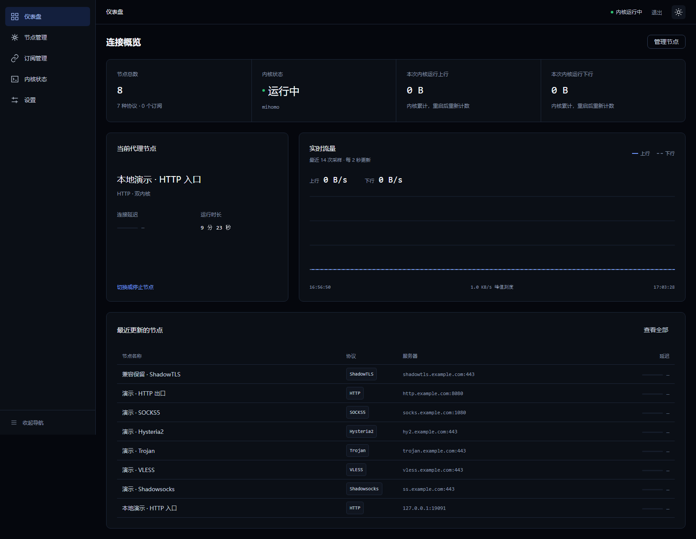
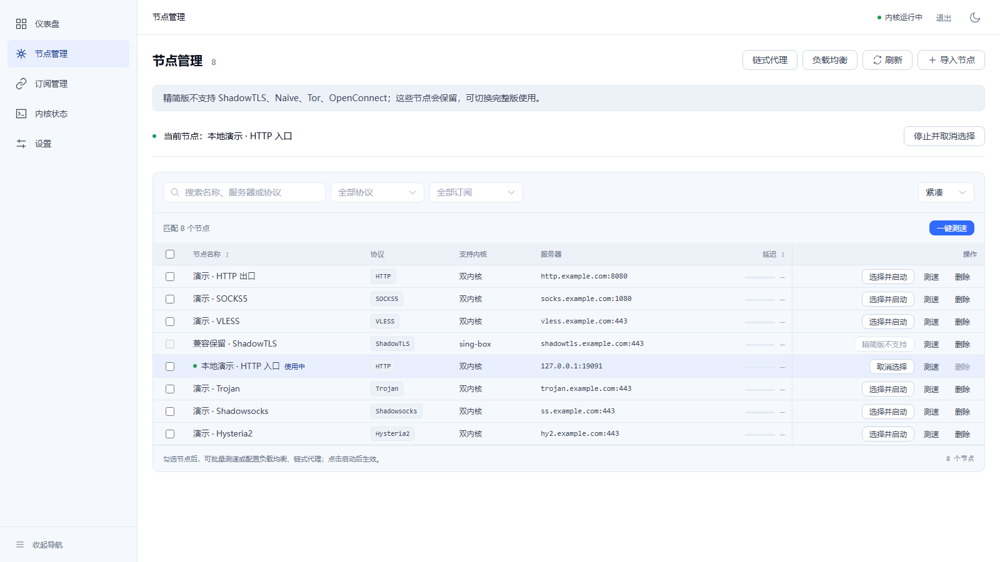
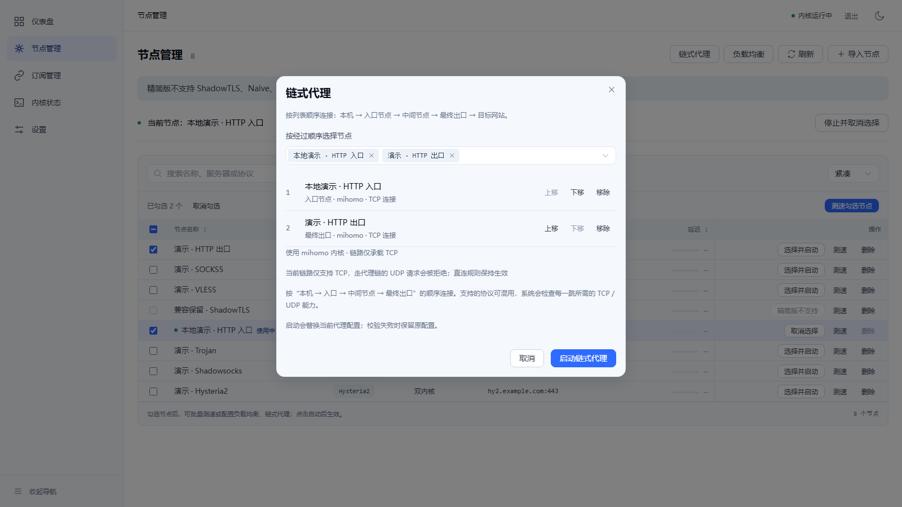
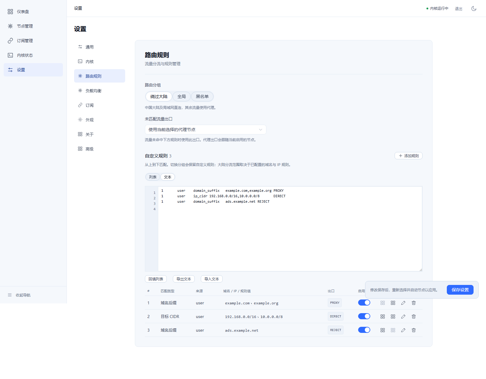

# DuoRelay: One Panel, Full or Lite

[简体中文](showcase.md) | English

**Lite archives start at 31.83 MB and retain the complete panel.**

DuoRelay combines a Go backend with a Vue 3 and TypeScript frontend to manage nodes, subscriptions, load balancing, proxy chains, routing rules and kernel status in one web panel. The repository provides full (sing-box and mihomo) and lite (mihomo only) builds with a shared version, panel code and data format.



*Live interface from the lite panel in an orca-linux container, with mihomo running. Screenshots use temporary demonstration data; traffic samples reflect the actual test state.*

## Measured Download Sizes

Measurements below were taken on 2026-11-03 from local `0.3.0` build artifacts. They do not indicate a new formal release. Archives contain the panel, corresponding kernel and bundled documentation; the production frontend is embedded. MB uses decimal units (1 MB = 1,000,000 bytes).

| Platform | Full archive | Lite archive | Format |
|---|---:|---:|---|
| Linux amd64 | 62.34 MB | **34.66 MB** | `.tar.gz` |
| Linux arm64 | 56.91 MB | **31.83 MB** | `.tar.gz` |
| Windows amd64 | 66.56 MB | **34.34 MB** | `.zip` |

Lite contains mihomo only; it does not include sing-box or `libcronet.dll`. Geo data is not bundled. On first start, lite downloads and caches it from the official source and reports download failures explicitly.

### Extracted Disk Contents

| Platform | Full extracted files | Lite extracted files | Lite files plus measured Geo cache |
|---|---:|---:|---:|
| Linux amd64 | 165.19 MB | 83.55 MB | **96.33 MB** |
| Linux arm64 | 154.12 MB | 77.98 MB | **90.76 MB** |
| Windows amd64 | 174.67 MB | 82.84 MB | **95.62 MB** |

The Geo cache downloaded for this measurement totaled **12.78 MB**: `GeoSite.dat` was 4,356,022 bytes and `geoip.metadb` was 8,424,898 bytes. The last column adds those bytes to each platform's extracted files; official data updates can change the result. Full extracted sizes exclude Geo and retain their existing acquisition behavior.

These are file-content sizes, not runtime memory or allocated disk space. They exclude user databases, generated configuration and logs. See [package measurements](lite-package-sizes.json) for raw bytes and archive contents.

## Smaller Kernel, Full Management Panel

| Capability | Full | Lite |
|---|---|---|
| Kernels | sing-box + mihomo | mihomo |
| Protocol, endpoint and networking capability model | 28 | 24 available through mihomo |
| Node and subscription management | Yes | Yes |
| Multi-node load balancing | Yes | Yes |
| Proxy chains | Native and cross-kernel bridge | Native mihomo chains |
| Routing list and text editor | Yes | Yes |
| Transparent proxy modes | off / redirect / tproxy / tun | Same, subject to environment |
| Configuration application | Real-kernel validation and rollback on failure | Same |
| Data format and subscription encryption | Shared between variants | Shared between variants |

Lite does not support ShadowTLS, Naive, Tor or OpenConnect. Existing nodes using these protocols remain in the list; start and group-selection controls explain that lite cannot run them. Switch to full to use them when supported by the selected kernel. Protocol coverage describes the model, parsing and configuration-generation scope; it does not mean every protocol has passed remote connectivity testing. See [full and lite details](lite.en.md).

### Manage Nodes in One Place

Search, protocol filters, bulk selection, latency tests and activation are grouped on one page. Lite identifies unsupported nodes before an operation, while retaining existing data.



*Demonstration nodes use example domains such as `example.com`; the active endpoint is a temporary local HTTP listener. Untested status is shown as-is and does not prove public-node availability or latency.*

### Build Chains in Order

Choose each hop from entry to final exit, adjust its order and review the kernel and TCP/UDP capability. Applying a configuration still invokes real kernel validation; on failure, the prior configuration is kept or restored.



*This is a configuration preview; the chain using example domains was not started.*

### Switch Between Routing List and Text

Manage rules as a list or edit, import and export them in bulk as text. Routing text remains structured and validated; arbitrary raw kernel JSON/YAML cannot be applied.



## Switch Variants and Keep Existing Data

Full and lite share node, subscription and rule formats. Database keys and subscription encryption are unchanged. An isolated container verified full → lite → full and lite-created data → full consistency.

Stop the service before switching and back up the entire data directory, especially the database and its matching `.key` file. Replace the panel and corresponding kernel, then start with the same data path. Do not let two instances manage one database at the same time. A full configuration using sing-box or cross-kernel runtime cannot be restored directly in lite; select a mihomo-compatible node and apply it again. See [data compatibility and in-place upgrades](lite.en.md#data-compatibility-and-in-place-upgrades).

## Build from Source

Prepare Go, Node.js and frontend dependencies as described in the [development guide](DEVELOPMENT.en.md), then select a target:

```bash
make build       # full
make build-lite  # lite

# Linux lite, including mihomo for the target architecture
bash scripts/package-linux.sh 0.3.0 amd64 --lite
bash scripts/package-linux.sh 0.3.0 arm64 --lite --kernels-dir /path/to/linux-arm64-kernels
```

For Windows lite:

```powershell
powershell -File scripts/package-windows.ps1 -Version 0.3.0 -Lite
```

See the [project README](../README.en.md), [Linux deployment](linux-deployment.en.md) and [Windows deployment](windows-deployment.en.md) for runtime options.

## Screenshot and Verification Scope

The four images on this page come from the Linux amd64 lite panel started with local `orca-linux`, using a temporary database, account and demonstration nodes. Orca's embedded browser produced incorrect screenshots at expanded viewport sizes, so standalone Chromium captured the same instance directly. The UI was not replaced, API responses were not intercepted, and latency data was not fabricated. Images are stored with this document in the repository.

Default full/lite Go tests and vet, frontend type checking, 53 frontend tests and production builds passed; six target archives were built. An isolated container exercised real proxy requests, routing, load balancing, native chains, data compatibility, and transparent-proxy rule/TUN lifecycles.

Real Windows/Linux/macOS system acceptance, arm64 hardware execution, end-to-end transparent forwarding and DNS leak checks remain **UNVERIFIED**. Two opt-in full HTTP chain tests failed and the same failures were reproduced on the unchanged baseline. The [acceptance report](lite-acceptance.en.md) records the details.
