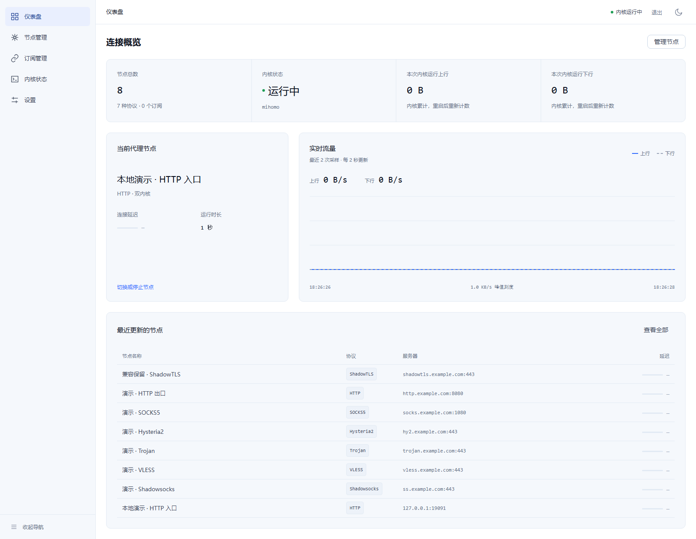
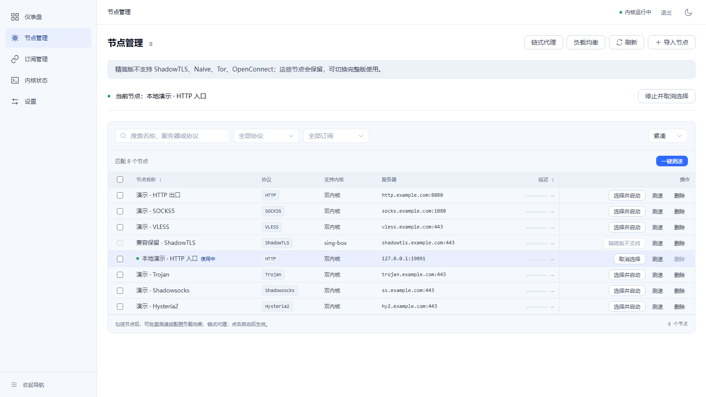
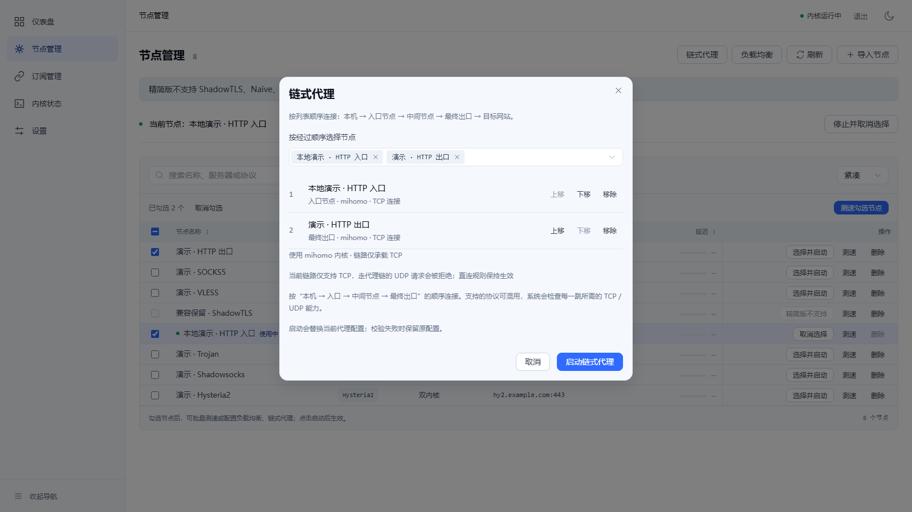
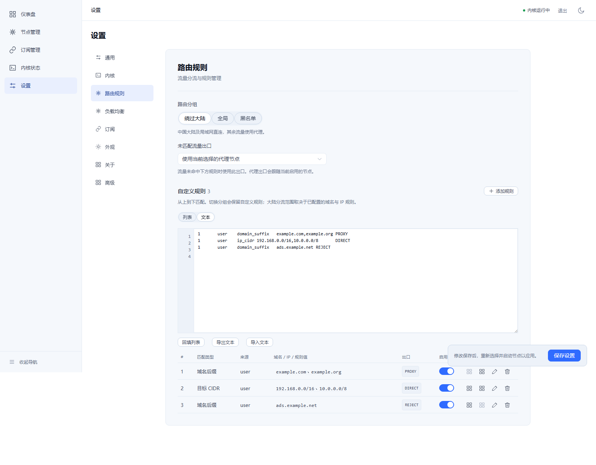

# DuoRelay：一套面板，full / lite 按需选择

**lite 压缩包 31.83 MB 起，保留完整面板。**

DuoRelay 使用 Go 后端与 Vue 3 + TypeScript 前端，把节点、订阅、负载均衡、链式代理、路由规则和内核运行状态放在同一个 Web 面板中。同一仓库提供双核 full 与 mihomo 单核 lite，共用版本号、面板代码和数据格式。



*实际运行界面：orca-linux 容器中的 lite 面板，mihomo 已启动。截图使用临时演示数据，流量采样按实际状态显示。*

## 下载体积，直接看实测

下面是 2026-11-03 对 `0.3.0` 本地构建产物的测量，不代表新增正式发行版。压缩包包含面板、对应内核和随包文档；面板已嵌入生产前端。所有 MB 均为十进制，1 MB = 1,000,000 字节。

| 平台 | full 压缩包 | lite 压缩包 | 包格式 |
|---|---:|---:|---|
| Linux amd64 | 62.34 MB | **34.66 MB** | `.tar.gz` |
| Linux arm64 | 56.91 MB | **31.83 MB** | `.tar.gz` |
| Windows amd64 | 66.56 MB | **34.34 MB** | `.zip` |

lite 包内仅包含 mihomo 内核，不包含 sing-box 或 `libcronet.dll`。Geo 数据不随包分发，lite 首次启动从官方渠道下载并缓存，下载失败会明确报错。

### 解压后占多少空间

| 平台 | full 解压文件 | lite 解压文件 | lite 文件 + 本次 Geo 缓存 |
|---|---:|---:|---:|
| Linux amd64 | 165.19 MB | 83.55 MB | **96.33 MB** |
| Linux arm64 | 154.12 MB | 77.98 MB | **90.76 MB** |
| Windows amd64 | 174.67 MB | 82.84 MB | **95.62 MB** |

本次实际下载的 Geo 缓存合计 **12.78 MB**：`GeoSite.dat` 为 4,356,022 字节，`geoip.metadb` 为 8,424,898 字节。最后一列是各平台解压文件与这份缓存的字节数相加；官方数据更新后会变化。full 解压列未计 Geo，full 的获取行为保持原状。

这些数值是文件内容大小，不是运行内存或磁盘分配空间；不含用户数据库、生成配置及运行日志。原始字节数与包内文件组成见 [体积测量明细](lite-package-sizes.json)。

## 精简内核，保留日常管理能力

| 能力 | full | lite |
|---|---|---|
| 内核 | sing-box + mihomo | mihomo |
| 协议、端点与组网能力模型 | 28 项 | mihomo 覆盖的 24 项 |
| 节点与订阅管理 | 支持 | 支持 |
| 多节点负载均衡 | 支持 | 支持 |
| 链式代理 | 原生与跨核桥接 | mihomo 原生链式 |
| 路由列表 / 文本编辑 | 支持 | 支持 |
| 透明代理模式 | off / redirect / tproxy / tun | 相同，受运行环境限制 |
| 配置应用 | 真核校验与失败回滚 | 真核校验与失败回滚 |
| 数据格式与订阅加密 | 两种变体共用 | 两种变体共用 |

lite 不支持 ShadowTLS、Naive、Tor、OpenConnect。已有这些协议的节点会保留在列表中，启动和组合选择入口显示“精简版不支持”；切换 full 后可继续按相应内核能力使用。协议覆盖指模型、解析与配置生成边界，不代表每项协议都完成了远端连通测试。详细对照见 [full / lite 说明](lite.md)。

### 节点集中管理，能力边界直接可见

搜索、协议筛选、批量勾选、测速与启动集中在一个页面。lite 会在操作前标明不支持的节点，已有数据仍然保留。



*演示节点使用 `example.com` 等示例域名；当前运行的是临时本地 HTTP 入口。截图中的未测速状态保持原样，不作为公网节点可用性或延迟证明。*

### 链路按顺序组织，启动前检查能力

从入口到最终出口逐跳选择、调整顺序，面板展示所用内核及 TCP / UDP 能力。应用配置时仍调用真实内核校验，失败时保留或恢复原配置。



*截图展示配置预览，未启动这条使用示例域名的链路。*

### 路由列表与文本编辑，自由切换

可用列表管理规则，也可通过文本批量编辑、导入和导出。路由文本仍是受校验的结构化规则；原始内核 JSON / YAML 不开放自由应用。



## 切换变体，继续使用已有数据

full 与 lite 使用相同的节点、订阅和规则格式，不改变数据库密钥与订阅加密方式。隔离容器已验证 full → lite → full，以及 lite 新建数据 → full 的内容一致性。

切换前停止服务，备份整个数据目录，尤其是数据库及其配套 `.key` 文件；替换面板和对应内核后，以相同数据路径启动。不要让两个实例同时管理同一份数据库。full 原有 sing-box 或跨核运行配置不能直接在 lite 恢复，需要选择兼容的 mihomo 节点重新应用。操作步骤见 [数据互通与覆盖安装](lite.md#数据互通与覆盖安装)。

## 从源码构建

先按 [开发指南](DEVELOPMENT.md) 准备 Go、Node.js 与前端依赖，再选择构建目标：

```bash
make build       # full
make build-lite  # lite

# Linux lite，包含目标架构的 mihomo
bash scripts/package-linux.sh 0.3.0 amd64 --lite
bash scripts/package-linux.sh 0.3.0 arm64 --lite --kernels-dir /path/to/linux-arm64-kernels
```

Windows lite：

```powershell
powershell -File scripts/package-windows.ps1 -Version 0.3.0 -Lite
```

部署和运行参数见 [项目 README](../README.md)、[Linux 部署](linux-deployment.md) 与 [Windows 部署](windows-deployment.md)。

## 展示与验证范围

本页四张图片来自通过本机 `orca-linux` 启动的 Linux amd64 lite 面板，使用临时数据库、临时账号和演示节点。图片使用独立 Chromium 对实际运行页面直接截图，仪表盘已更新为浅色主题；没有替换界面内容、拦截 API 或填充虚构测速数据。图片随文档存放在仓库内，可直接用于 Markdown 展示。

full / lite 默认 Go 测试、vet、前端类型检查、53 项前端测试及生产构建通过，六个目标包已构建。隔离容器中完成了真实代理请求、路由分流、负载均衡、原生链式、数据互通和透明代理规则 / TUN 生命周期检查。

Windows / Linux / macOS 真实系统验收、arm64 实际运行、透明转发端到端流量与 DNS 泄漏检测仍为 **UNVERIFIED**。额外启用的 full HTTP 链式测试有两项失败，已在未修改基线复现；不将其宣传为全部通过。完整记录见 [验收报告](lite-acceptance.md)。
